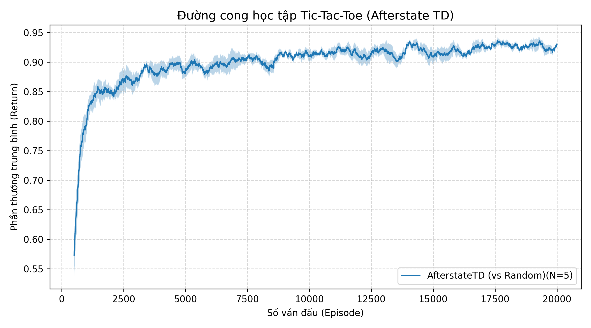
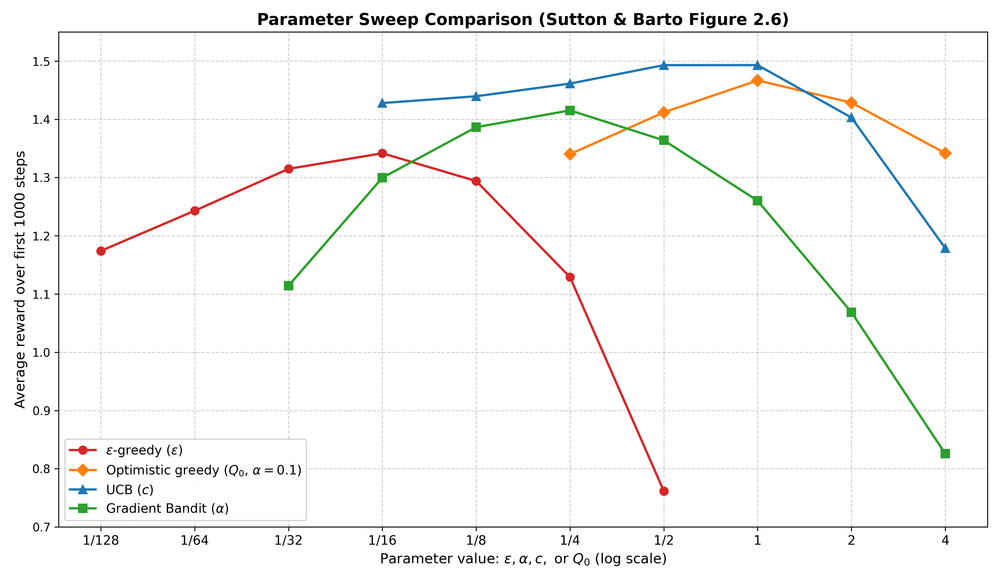

<div align="center">

# 🤖 MiniRL: Reinforcement Learning from Scratch

<p><strong>Clean, modular Reinforcement Learning library implemented from first principles for Embodied AI (2026–2028 Roadmap)</strong></p>
<p><em>Built strictly following Sutton & Barto (2018) specifications • Developed with Test-Driven Development (TDD)</em></p>

<p>
  <a href="https://www.python.org/"></a>
  <a href="https://numpy.org/"></a>
  <a href="https://matplotlib.org/"></a>
  <a href="https://docs.pytest.org/"></a>
  
  <a href="LICENSE"></a>
</p>

<p>
  <a href="#overview">Overview</a> •
  <a href="#architecture">Architecture</a> •
  <a href="#installation">Installation</a> •
  <a href="#weekly-implementations">Weekly Implementations</a> •
  <a href="#testing">Testing</a>
</p>

<table border="0">
  <tr>
    <td width="50%" align="center">
      <strong>Week 01: Afterstate TD(0) Convergence</strong><br>
      
    </td>
    <td width="50%" align="center">
      <strong>Week 02: Multi-Armed Bandit Parameter Sweep</strong><br>
      
    </td>
  </tr>
</table>

---

</div>

## Table of Contents
- [Overview](#overview)
- [Architecture](#architecture)
- [Installation](#installation)
- [Weekly Implementations](#weekly-implementations)
  - [Week 01: Tic-Tac-Toe (Afterstate TD)](#week-01-tic-tac-toe-afterstate-td)
  - [Week 02: Multi-Armed Bandits](#week-02-multi-armed-bandits)
- [Testing](#testing)

---

## Overview

MiniRL provides clean, reproducible implementations of foundational reinforcement learning algorithms. Every component is verified with unit tests and evaluated across multiple random seeds using standard statistical metrics (Mean ± SEM).

---

## Architecture

- `minirl.core`: Protocol definitions (`Env`, `Agent`), `Transition` schema, and the standardized `run_episode` loop.
- `minirl.utils`: Seeded RNG generation (`seeding.py`), episodic CSV logging (`logger.py`), and moving average curve plotting (`plotting.py`).
- `minirl.envs`: Custom and benchmark environments.
- `minirl.agents`: Value-based, policy-based, and model-based RL agents.

---

## Installation

```bash
# Clone the repository
git clone https://github.com/mixp123/rl-from-scratch.git
cd rl-from-scratch

# Create and activate environment
python3 -m venv .venv
source .venv/bin/activate

# Install in editable mode with development dependencies
pip install -e ".[dev]"
```

---

## Weekly Implementations

### Week 01: Tic-Tac-Toe (Afterstate TD)

- **Problem**: 3x3 board game against a stochastic opponent.
- **Method & Algorithm**: Afterstate Temporal Difference Learning ($TD(0)$). Rather than evaluating state-action pairs $(s, a)$, the value function directly evaluates the afterstate $S'$ immediately following the agent's move:
  $$V(S'_{t-1}) \leftarrow V(S'_{t-1}) + \alpha \big[ V(S'_t) - V(S'_{t-1}) \big]$$
  Exploration is controlled via $\epsilon$-greedy action selection over candidate afterstates.
- **Results**: Evaluated across 5 random seeds with 20,000 episodes per seed. The agent reaches convergence within 3,000–5,000 episodes, effectively eliminating losses against random play.
- **Artifacts & Evidence**:
  - Environment: [`minirl/envs/tictactoe.py`](minirl/envs/tictactoe.py)
  - Agent: [`minirl/agents/td_value.py`](minirl/agents/td_value.py)
  - Test Suite: [`weeks/w01-tictactoe/week01_test/test_w01_tictactoe.py`](weeks/w01-tictactoe/week01_test/test_w01_tictactoe.py)
  - Benchmark Data: [`weeks/w01-tictactoe/results/`](weeks/w01-tictactoe/results/)
  - Interactive Simulator: [`weeks/w01-tictactoe/play.py`](weeks/w01-tictactoe/play.py)


---

### Week 02: Multi-Armed Bandits

- **Problem**: Stationary and non-stationary 10-armed bandit testbed ($q_*(a) \sim \mathcal{N}(0, 1)$).
- **Method & 3 Core Algorithms**:
  1. **$\epsilon$-Greedy**: Balances exploration and exploitation via action-value updates with sample-average or constant step-size ($\alpha$) for non-stationary tracking:
     $$Q_{t+1}(A_t) \leftarrow Q_t(A_t) + \alpha \big[ R_t - Q_t(A_t) \big]$$
  2. **Upper Confidence Bound (UCB1)**: Deterministic exploration guided by parameter uncertainty derived from Hoeffding's inequality:
     $$A_t = \arg\max_a \left[ Q_t(a) + c \sqrt{\frac{\ln t}{N_t(a)}} \right]$$
  3. **Gradient Bandit with Baseline**: Softmax preference learning with an incremental sample-average baseline $\bar{R}_t$ for variance reduction:
     $$H_{t+1}(a) \leftarrow H_t(a) + \alpha (R_t - \bar{R}_t) \big[ \mathbb{I}_{a = A_t} - \pi_t(a) \big], \quad \pi_t(a) = \frac{e^{H_t(a)}}{\sum_b e^{H_t(b)}}$$
- **Results**: Evaluated over 2,000 independent bandit tasks with 1,000 steps per run (Sutton & Barto 2018, Chapter 2):
  - **UCB** ($c = 2$) achieves superior early exploration and asymptotic accuracy ($>80\%$ optimal action), outperforming standard $\epsilon$-greedy.
  - **Gradient Bandit** converges to $>83\%$ optimal action; the baseline $\bar{R}_t$ proves crucial for stability under shifted reward distributions.
  - **Parameter Sweep (Figure 2.6)** confirms characteristic inverted-U performance profiles across exploration rates, step sizes, and initial values.
- **Artifacts & Evidence**:
  - Environment: [`minirl/envs/bandit.py`](minirl/envs/bandit.py)
  - Agents: [`minirl/agents/bandit_agents.py`](minirl/agents/bandit_agents.py)
  - Experiment & Sweep: [`weeks/w02-bandits/run.py`](weeks/w02-bandits/run.py), [`weeks/w02-bandits/sweep.py`](weeks/w02-bandits/sweep.py)
  - Mathematical Derivations: [`proofs/w02.pdf`](proofs/w02.pdf)
  - Test Suite: [`weeks/w02-bandits/week02_test/`](weeks/w02-bandits/week02_test/)
  - Weekly Report: [`weeks/w02-bandits/README.md`](weeks/w02-bandits/README.md)


---

## Testing

Run the full pytest suite to verify all core components and algorithms:

```bash
pytest
```
