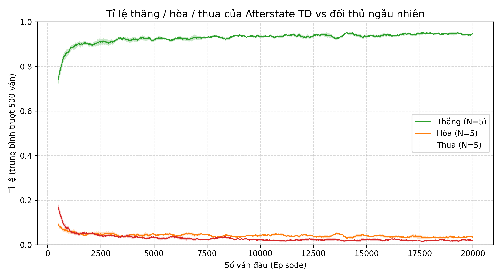
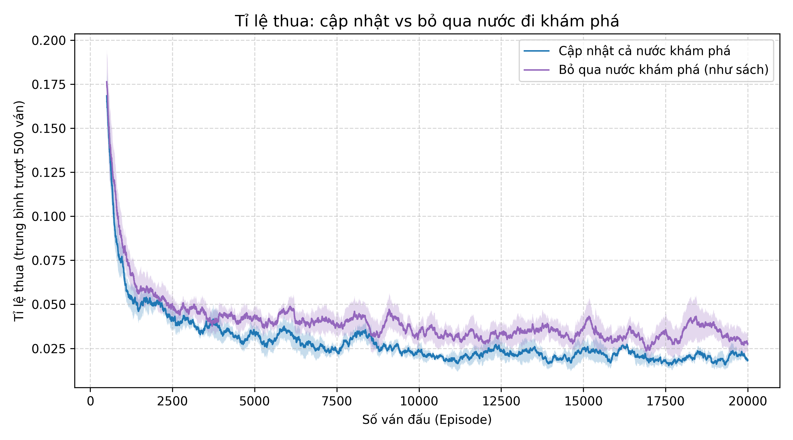

# Tuần 01 · Khung minirl và Tic-Tac-Toe

## Mục đích

Dựng một khung chạy thí nghiệm dùng chung cho cả lộ trình (giao diện `Env`/`Agent`, một vòng lặp `run_episode`, seed cố định, log CSV, vẽ trung bình ± sai số chuẩn), rồi kiểm tra khung bằng bài toán nhỏ mà biết đáp án: agent TD học bảng giá trị chơi Tic-Tac-Toe (S&B mục 1.5). Các tuần sau chỉ việc cắm thuật toán và môi trường mới vào khung này để kết quả so sánh được với nhau.

## Cách chạy

```bash
pip install -e ".[dev]"

# Huấn luyện: 5 seed x 20.000 ván -> results/
python weeks/w01-tictactoe/run.py --seeds 0 1 2 3 4 --episodes 20000

# (Tùy chọn) biến thể không cập nhật sau nước đi khám phá -> results_no_explore/
python weeks/w01-tictactoe/run.py --no_explore_update

# Vẽ hình -> figures/
python weeks/w01-tictactoe/plot.py

# Chạy test
pytest weeks/w01-tictactoe tests/test_core.py

# Chơi thử với agent đã học
python weeks/w01-tictactoe/play.py
```

## Thiết lập

| Thành phần | Chi tiết |
|---|---|
| Môi trường | Bàn 3×3, agent đi X trước, đối thủ ngẫu nhiên nằm trong môi trường. Reward: +1 thắng, 0 hòa, −1 thua |
| Agent | `AfterstateTD`: bảng V cho afterstate (bàn cờ ngay sau nước đi của agent), chọn nước ε-greedy theo V |
| Cập nhật | $V(S'_{t-1}) \leftarrow V(S'_{t-1}) + \alpha\,[\,V(S'_t) - V(S'_{t-1})\,]$; cuối ván dùng mục tiêu 1 (thắng), 0,5 (hòa), 0 (thua) |
| Siêu tham số | α = 0,1, ε = 0,1, V khởi tạo 0,5 |
| Thực nghiệm | 5 seed (0–4) × 20.000 ván, tất cả đều học trực tuyến (có ε-khám phá) |

## Kết quả



Trung bình ± SE (5 seed), tính trên **2.000 ván cuối** mỗi seed:

| Chỉ số | Cập nhật cả nước khám phá | Bỏ qua nước khám phá (như sách) |
|---|---|---|
| Thắng | 0,946 ± 0,002 | 0,908 ± 0,009 |
| Hòa | 0,034 ± 0,003 | 0,058 ± 0,006 |
| Thua | 0,020 ± 0,001 | 0,034 ± 0,006 |
| **Không thua** | **0,980 ± 0,001** | 0,966 ± 0,006 |

Lưu ý: các tỉ lệ đo trong lúc huấn luyện, nên vẫn gồm cả các nước đi ngẫu nhiên do ε = 0,1. Phần "thua" còn lại một phần là do khám phá, không hẳn do agent chưa học tốt.

### So sánh có và không cập nhật sau nước đi khám phá



Trong thiết lập này, bỏ qua nước khám phá (đúng như sách) lại cho tỉ lệ thua cao hơn một chút và dao động giữa các seed lớn hơn. Chênh lệch tỉ lệ thua khoảng 0,014, cỡ 2 lần SE, nên mới là dấu hiệu chứ chưa đủ để kết luận chắc với 5 seed.

Đường cong return trung bình: [`figures/learning_curve.png`](figures/learning_curve.png).

## Đối chiếu tiêu chí

- [x] Không thua ≥ 90% số ván trước đối thủ ngẫu nhiên sau 20.000 ván (5 seed): đạt 0,980 ± 0,001
- [x] Mọi test qua (30 test: env, agent, core, logger, plotting)
- [x] Chạy lại cùng seed ra cùng kết quả (có test `test_same_seed_gives_same_results`)
- [x] DFS từ bàn trống đếm đúng 5.478 trạng thái hợp lệ (có test)
- [x] Nhận đúng 8 đường thắng, không cho đi vào ô đã có quân (có test)
- [x] Đồ thị tỉ lệ thắng, hòa, thua theo số ván, trung bình ± SE
- [x] Cài cả hai cách cập nhật (có và không có nước khám phá) và so sánh
- [ ] Thí nghiệm agent tự chơi với chính nó, kiểm tra tỉ lệ hòa tăng dần: đang làm

## Chứng minh

[`proofs/w01.pdf`](../../proofs/w01.pdf):
- Định lý 1: với α không đổi, $V_n=(1-\alpha)^nV_0+\sum_{i=1}^{n}\alpha(1-\alpha)^{n-i}G_i$ và tổng các trọng số bằng 1.
- Định lý 2: với $\alpha_n = 1/n$, $V_n$ đúng bằng trung bình cộng $\frac1n\sum_{i=1}^n G_i$.

Mức tự làm: *(điền: tự làm hoàn toàn / cần gợi ý / cần phác thảo)*

## Cấu trúc thư mục

```
weeks/w01-tictactoe/
├── README.md
├── run.py                 # huấn luyện: --seeds, --episodes, --no_explore_update
├── plot.py                # sinh toàn bộ hình trong figures/
├── play.py                # chơi thử với agent đã học
├── week01_test/           # test của tuần
├── results/               # seed_0..4.csv, config.json, agent_v_table.pkl
├── results_no_explore/    # biến thể bỏ qua nước khám phá
└── figures/               # outcomes.png, learning_curve.png, compare_explore.png
```

Mã nguồn dùng chung: `minirl/core.py`, `minirl/utils/{seeding,logger,plotting}.py`, `minirl/envs/tictactoe.py`, `minirl/agents/td_value.py`.

## Ba điều rút ra

*(Phần này hãy viết lại bằng lời của bạn. Gợi ý từ số liệu:)*

1. Tỉ lệ thua giảm từ ~17% (ván 500) xuống ~4% sau khoảng 3.000 ván, rồi chỉ giảm chậm đến ~2% ở ván 20.000: phần lớn việc học diễn ra sớm.
2. Bỏ qua nước khám phá không tự động tốt hơn. Với đối thủ ngẫu nhiên, học cả từ nước khám phá cho kết quả tốt hơn và ổn định hơn giữa các seed.
3. Khung chung giúp việc này gọn: đổi một cờ trong `run.py` là có một biến thể mới, và cùng một `plot.py` so sánh được cả hai.
