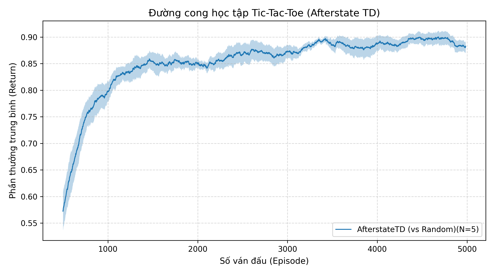

# Week 01: Tic-Tac-Toe & Afterstate TD Learning

Thực nghiệm thuật toán **Afterstate Temporal Difference (TD) Learning** trên môi trường cờ ca-rô 3x3 theo giáo trình *Sutton & Barto (2018), Mục 1.5*.

---

## 🎯 Mục tiêu & Ý tưởng Afterstate

Khác với hàm giá trị trạng thái thông thường $V(s)$ hay hàm giá trị hành động $Q(s, a)$, thuật toán đánh giá trực tiếp **Afterstate** (trạng thái bàn cờ ngay sau khi Agent đặt quân nhưng trước khi đối thủ phản ứng):
* **Lợi thế**: Các nước đi khác nhau dẫn đến cùng một thế cờ đối xứng sẽ có chung một Afterstate $\Rightarrow$ Tiết kiệm không gian bộ nhớ và tốc độ hội tụ nhanh hơn đáng kể.
* **Quy tắc cập nhật**:
  $$V(S'_{t-1}) \leftarrow V(S'_{t-1}) + \alpha \big[ V(S'_t) - V(S'_{t-1}) \big]$$

---

## 📁 Cấu trúc thư mục

* [`run.py`](run.py): Huấn luyện Agent qua 5 seeds ngẫu nhiên (`[0, 1, 2, 3, 4]`), mỗi seed $20.000$ episodes và lưu kết quả vào thư mục `results/`.
* [`plot.py`](plot.py): Đọc dữ liệu CSV từ `results/`, làm mượt bằng moving average (cửa sổ 500 ván) và vẽ đồ thị kèm dải bóng sai số chuẩn ($\text{Mean} \pm \text{SEM}$).
* [`play.py`](play.py): Trình mô phỏng giao diện dòng lệnh (CLI Simulator) cho phép người chơi trực tiếp đấu cờ với Agent đã huấn luyện.
* [`results/`](results/): Chứa các tệp dữ liệu thô `seed_*.csv`, cấu hình `config.json` và trọng số model `agent_v_table.pkl`.
* [`figures/`](figures/): Chứa đồ thị học tập [`learning_curve.png`](figures/learning_curve.png).

---

## 📊 Kết quả thực nghiệm

* **Quan sát**: Ban đầu phần thưởng trung bình ở mức thấp do Agent đi ngẫu nhiên để khám phá ($\epsilon = 0.1$). Sau khoảng 3.000–5.000 episodes, tỷ lệ thắng/hòa tăng vọt và đường cong tiệm cận mức giá trị tối ưu, độ lệch chuẩn giữa các hạt giống thu hẹp lại.
