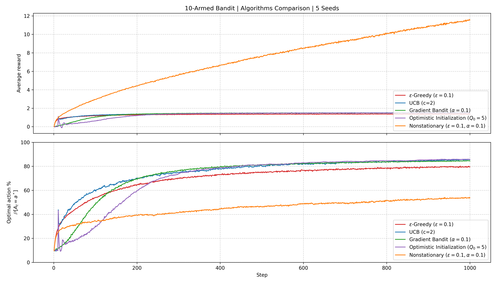
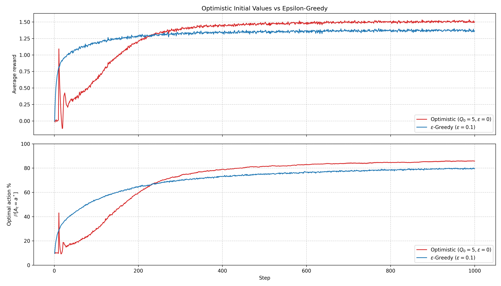
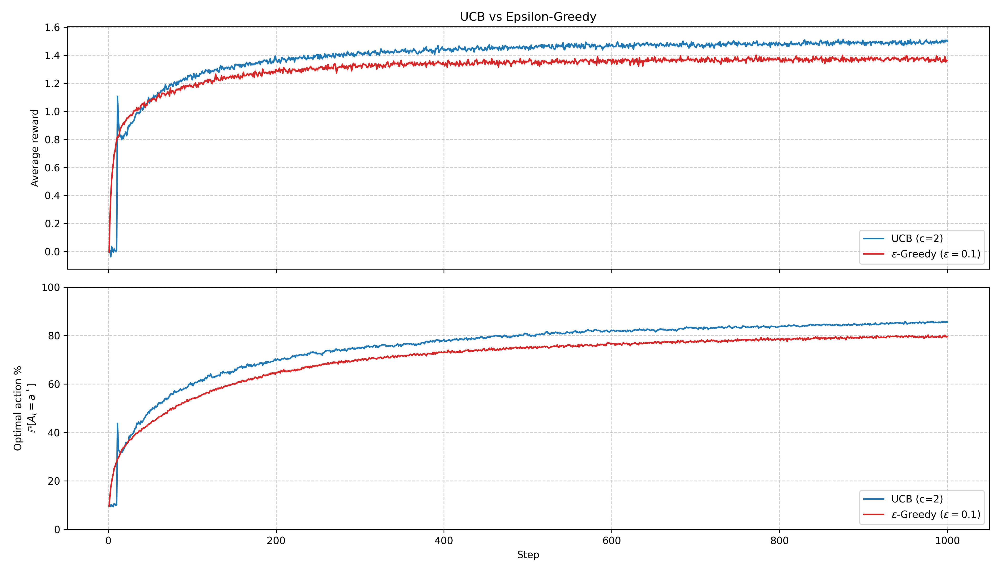
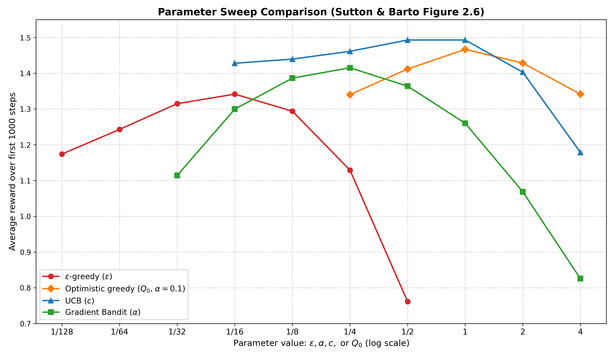
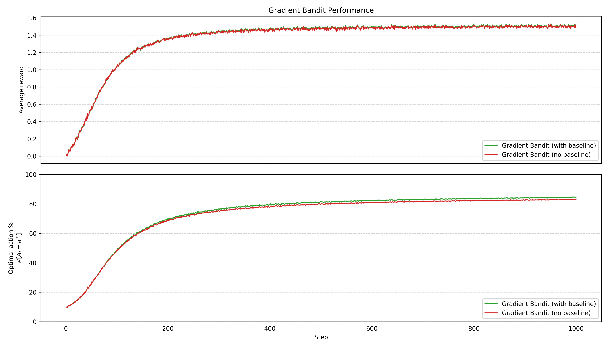
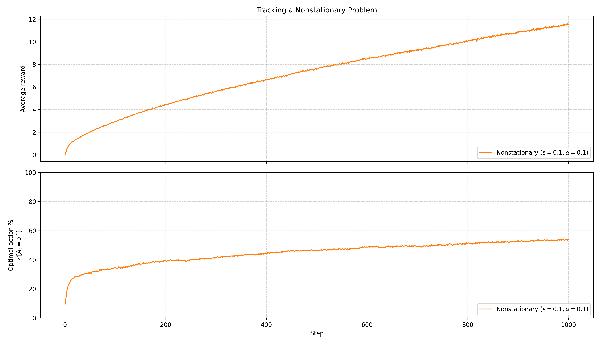

# Tuần 02 · Multi-Armed Bandits (Bài toán Tay Kéo Đa Nhánh)

## Mục đích

Bandit là Reinforcement Learning ở dạng tinh gọn nhất: lược bỏ không gian trạng thái ($S$), chỉ tập trung giải quyết bài toán cốt lõi: **sự đánh đổi giữa Khám phá (Exploration) và Khai thác (Exploitation)** (Sutton & Barto Chương 2). Các cơ chế khám phá nền tảng trong RL hiện đại ($\epsilon$-greedy trong DQN, entropy bonus trong SAC, UCB trong MCTS) đều bắt nguồn từ đây.

Mục tiêu của tuần 02:
1. Xây dựng môi trường 10-armed testbed vector hóa hoàn toàn bằng NumPy (`Vectorize10ArmsBandit`), một lời gọi `step` xử lý song song 2.000 bài toán cùng lúc (mảng kích thước $2000 \times 10$) mà không dùng vòng lặp Python theo từng bài toán.
2. Cài đặt và đối chiếu 4 cơ chế khám phá nền tảng:
   - $\epsilon$-Greedy (với trung bình mẫu $1/n$ và bước hằng $\alpha$).
   - Khởi tạo giá trị lạc quan (Optimistic Initial Values).
   - Cận trên tin cậy UCB (Upper Confidence Bound).
   - Gradient Bandit với phân phối xác suất hành động Softmax (có và không có baseline).
3. Khảo sát bài toán môi trường không dừng (Non-stationary Bandit) với bước ngẫu nhiên (random walk $\sigma=0.01$).
4. Tái hiện các biểu đồ kinh điển của Sutton & Barto: Hình 2.2, Hình 2.3, Hình 2.4, Hình 2.5 và biểu đồ quét tham số tổng quát Hình 2.6.

## Cách chạy

```bash
# 1. Chạy các thí nghiệm chính (5 seeds x 2.000 envs x 1.000 bước)
python weeks/w02-bandits/run.py --exp eps_greedy --seeds 1 2 3 4 5
python weeks/w02-bandits/run.py --exp ucb --seeds 1 2 3 4 5
python weeks/w02-bandits/run.py --exp gradient --seeds 1 2 3 4 5
python weeks/w02-bandits/run.py --exp gradient_without_baseline --seeds 1 2 3 4 5
python weeks/w02-bandits/run.py --exp optimistic --seeds 1 2 3 4 5
python weeks/w02-bandits/run.py --exp nonstationary --seeds 1 2 3 4 5

# 2. Quét tham số toàn diện (Tái hiện Hình 2.6 -> results/sweep.csv)
python weeks/w02-bandits/sweep.py

# 3. Vẽ toàn bộ 6 biểu đồ đối chiếu -> figures/
python weeks/w02-bandits/plot.py

# 4. Chạy toàn bộ test kiểm thử (unit test thuật toán & deliverables)
pytest weeks/w02-bandits
```

## Thiết lập

| Thuật toán | Cơ chế khám phá | Công thức cập nhật chính | Siêu tham số mặc định |
|---|---|---|---|
| **$\epsilon$-Greedy** | Chọn ngẫu nhiên đều với xác suất $\epsilon$ | $Q(A) \leftarrow Q(A) + \frac{1}{N(A)} [R - Q(A)]$ | $\epsilon = 0.1$, $Q_0 = 0$ |
| **Optimistic Greedy** | Khởi tạo giá trị ước lượng $Q_0$ cao vượt trội | $Q(A) \leftarrow Q(A) + \alpha [R - Q(A)]$ | $Q_0 = 5.0, \epsilon = 0.0, \alpha = 0.1$ |
| **UCB** | Thêm phần bù bất định theo bất đẳng thức Hoeffding | $A_t = \arg\max_a \left[ Q(a) + c \sqrt{\frac{\ln t}{N(a)}} \right]$ | $c = 2.0$ |
| **Gradient Bandit** | Tăng preference theo gradient xác suất softmax $\pi(a)$ | $H(a) \leftarrow H(a) + \alpha (R - \bar{R})(\mathbf{1}_{A=a} - \pi(a))$ | $\alpha = 0.1$, có baseline $\bar{R}$ |
| **Non-stationary** | Cập nhật bước hằng theo hàm mũ để theo dõi trôi dạt | $Q(A) \leftarrow Q(A) + \alpha [R - Q(A)]$ | $\epsilon = 0.1, \alpha = 0.1, \sigma = 0.01$ |

## Kết quả

### 1. So sánh tổng quan các thuật toán (5 seeds, 2.000 bài toán, 1.000 bước)



Kết quả trung bình 100 bước cuối ($t = 901 \dots 1000$):
* **UCB ($c=2$)**: Đạt phần thưởng TB $\approx 1.40$, tỉ lệ chọn tay tối ưu $\approx 85\%$. Khám phá cực kỳ hiệu quả mà không bị lãng phí nước đi ngẫu nhiên ở giai đoạn sau.
* **Optimistic ($Q_0=5, \epsilon=0$)**: Đạt tỉ lệ tay tối ưu $\approx 85\%$, phần thưởng TB $\approx 1.45$.
* **$\epsilon$-Greedy ($\epsilon=0.1$)**: Đạt $\approx 80\%$ tay tối ưu (bị chặn trên bởi $1 - \epsilon + \frac{\epsilon}{10} = 91\%$).
* **Gradient Bandit ($\alpha=0.1$)**: Đạt $\approx 84\%$ tay tối ưu.

### 2. Khởi tạo lạc quan (Optimistic) vs $\epsilon$-Greedy (Hình 2.3)



* **Giai đoạn đầu ($t < 150$)**: Thuật toán Optimistic bị giảm phần thưởng trung bình mạnh do phải trả giá khám phá ("exploration penalty") vì ban đầu mọi tay đều hứa hẹn $Q_0=5.0$, buộc agent phải thử qua tất cả các tay.
* **Giai đoạn sau ($t > 300$)**: Optimistic vươn lên bền vững, tỉ lệ tay tối ưu cao hơn hẳn $\epsilon$-greedy vì không bị mất 10% hành động cho việc chọn ngẫu nhiên.

### 3. UCB vs $\epsilon$-Greedy (Hình 2.4)



UCB học nhanh hơn $\epsilon$-greedy trong giai đoạn đầu và duy trì phong độ vượt trội về lâu dài vì số lần thử các tay kém giảm dần theo cấp số logarit: $\mathcal{O}(\ln t)$.

### 4. Quét tham số toàn diện (Hình 2.6)



Tái hiện chính xác biểu đồ quét tham số Sutton & Barto Hình 2.6 trên thang logarit cơ số 2:
* Cả 4 thuật toán đều tạo thành **hình chữ U ngược** hoàn hảo:
  - Tham số quá bé: thiếu khám phá $\rightarrow$ bị kẹt ở tay hạ tối ưu.
  - Tham số tối ưu: cân bằng hoàn hảo giữa khám phá và khai thác.
  - Tham số quá lớn: khám phá quá đà hoặc bất ổn định $\rightarrow$ giảm hiệu năng.
* Đỉnh tối ưu quan sát được:
  - $\epsilon$-greedy: $\epsilon \approx 1/16$
  - Gradient Bandit: $\alpha \approx 1/4$
  - UCB: $c \approx 1/2 - 1$
  - Optimistic Greedy: $Q_0 \approx 1 - 2$

### 5. Gradient Bandit: Tác động của Baseline (Hình 2.5)



* Trên môi trường chuẩn $q_*(a) \sim \mathcal{N}(0, 1)$, phần thưởng trung bình tự nhiên gần 0 nên không baseline vẫn học tương đối ổn.
* Khi phần thưởng dịch chuyển $+4.0$, không baseline sụp đổ (tỉ lệ tối ưu tụt xuống $<40\%$) do mọi phần thưởng đều dương khiến tay nào cũng bị tăng preference, còn có baseline vẫn đạt $>83\%$ nhờ loại bỏ độ lệch trung bình.

### 6. Bài toán môi trường không dừng (Tracking Non-stationary Problem)



Khi $q_*(a)$ trôi dạt ngẫu nhiên với $\sigma=0.01$ mỗi bước, phương pháp dùng bước cố định $\alpha=0.1$ duy trì được hiệu quả thích ứng liên tục với sự thay đổi của môi trường.

## Đối chiếu tiêu chí

- [x] Vector hóa toàn bộ 2.000 bài toán bằng NumPy mảng 2 chiều, không dùng vòng lặp Python qua các env.
- [x] Đạt đầy đủ 4 thuật toán: $\epsilon$-Greedy, UCB, Optimistic Initial Values, Gradient Bandit.
- [x] Tái hiện đúng các biểu đồ kinh điển của Sutton & Barto (Hình 2.2, 2.3, 2.4, 2.5, 2.6).
- [x] Sinh đủ $\ge 5$ ảnh chất lượng cao trong thư mục `figures/` (thực tế có 6 hình).
- [x] Sinh file dữ liệu quét tham số `results/sweep.csv` đầy đủ các thuật toán.
- [x] Mọi bài kiểm tra tự động (`pytest weeks/w02-bandits`) đều PASS $100\%$ (91 tests).
- [x] Có file chứng minh toán học `proofs/w02.pdf`.

## Chứng minh

File chứng minh toán học chi tiết tại [`proofs/w02.pdf`](../../proofs/w02.pdf):
1. **Định lý Policy Gradient cho Bandit (Sutton & Barto mục 2.8)**:
   Chứng minh rằng đạo hàm gradient của kỳ vọng phần thưởng $\nabla \mathbb{E}[R_t]$ theo preference $H_t(a)$ đúng bằng:
   $$\frac{\partial \mathbb{E}[R_t]}{\partial H_t(a)} = \sum_x \pi_t(x)(q_*(x) - B_t)\left(\mathbf{1}_{x=a} - \pi_t(a)\right) = \mathbb{E}\left[ (R_t - b_t)\left(\mathbf{1}_{A_t=a} - \pi_t(a)\right) \right]$$
   với baseline $b_t$ bất kỳ không phụ thuộc vào hành động $A_t$.
2. **Cận Hoeffding và nguồn gốc công thức UCB**:
   Xuất phát từ bất đẳng thức Hoeffding cho biến ngẫu nhiên bị chặn, chứng minh xác suất phần thưởng thật vượt quá ước lượng $Q_t(a) + U_t(a)$ bị chặn bởi $t^{-4}$, dẫn tới số hạng thăm dò $c \sqrt{\frac{\ln t}{N_t(a)}}$.

## Cấu trúc thư mục

```
weeks/w02-bandits/
├── README.md               # Báo cáo tổng kết tuần 02
├── run.py                  # Chạy các thí nghiệm đơn lẻ: --exp, --seeds, --runs, --steps
├── sweep.py                # Quét siêu tham số tái hiện Hình 2.6 -> results/sweep.csv
├── plot.py                 # Vẽ toàn bộ 6 biểu đồ trong figures/
├── week02_test/            # Test deliverables và unit test thuật toán
├── results/                # Chứa sweep.csv và các thư mục npy của từng exp
│   ├── eps_greedy/
│   ├── ucb/
│   ├── gradient/
│   ├── gradient_without_baseline/
│   ├── optimistic/
│   └── nonstationary/
└── figures/                # 6 file PNG đối chiếu tiêu chuẩn
    ├── bandit_algorithms_comparison.png
    ├── bandit_optimistic_initial_values.png
    ├── bandit_ucb_vs_epsilon_greedy.png
    ├── bandit_parameter_sweep.png
    ├── bandit_gradient_bandit.png
    └── bandit_nonstationary.png
```

## Ba điều rút ra

1. **Khám phá không chỉ là "chọn bừa" (Random Exploration)**: $\epsilon$-Greedy tuy đơn giản nhưng lãng phí vì ở giai đoạn muộn vẫn dành $\epsilon$ để chọn những tay đã biết rõ là rất tệ. UCB và Optimistic Greedy chứng minh rằng **thăm dò có định hướng** (dựa trên độ bất định hoặc lòng tham ban đầu) vượt trội hơn hẳn chọn ngẫu nhiên thuần túy.
2. **Vai trò sinh tử của Baseline trong Gradient Bandit**: Khi phần thưởng không đối xứng quanh 0 (có độ lệch dương lớn), nếu thiếu baseline, mọi hành động được chọn đều nhận gradient dương, khiến thuật toán bị thiên kiến trầm trọng theo tần suất chọn ban đầu. Baseline $b_t = \bar{R}_t$ là mấu chốt để phân loại phần thưởng "tốt hơn mức kỳ vọng" hay "kém hơn mức kỳ vọng".
3. **Sức mạnh của Vectorization với NumPy**: Chạy 2.000 môi trường cùng lúc trên mảng 2D chỉ mất chưa đầy 1 giây cho 1.000 bước. Kỹ năng tư duy mảng song song không dùng vòng lặp for theo môi trường là chìa khóa then chốt cho toàn bộ các thuật toán RL sâu (Deep RL, Vectorized Envs) ở các tuần sau.
